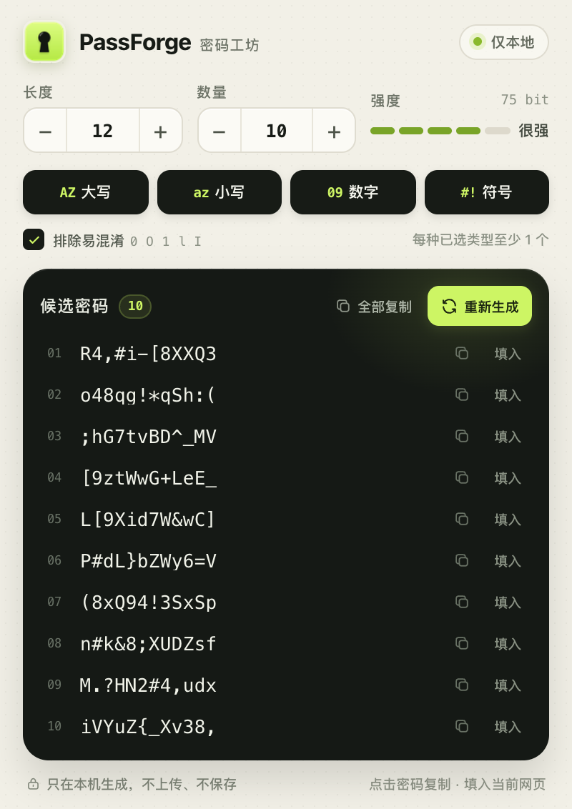
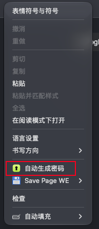

# PassForge 密码工坊

**注册密码，不再问 AI。** 一个专为批量生成注册密码而做的本地优先 Chrome 扩展（Manifest V3）。

默认打开就是 **10 个候选 × 12 位，大小写字母 + 数字 + 符号**，和你平时让 AI 生成的规格一致。长度、数量、字符类型都能独立调整。支持一键复制、填入网页，以及在密码框上右键直接生成。

[](https://github.com/BrathonBai/passforge/actions/workflows/ci.yml)
[](LICENSE)



*截图中的密码仅用于演示。*

> **A local-first Chrome password generator.** Batch-generate strong passwords locally, copy them, or fill them on demand. No network calls, no password storage, no broad host permissions. See [English summary](#english).

**源码与主页**：[github.com/BrathonBai/passforge](https://github.com/BrathonBai/passforge) · **下载**：[GitHub Releases](https://github.com/BrathonBai/passforge/releases/latest) · **隐私政策**：[PRIVACY.md](https://github.com/BrathonBai/passforge/blob/main/PRIVACY.md)


## 功能

- **批量候选**：默认一次生成 10 个 12 位密码；数量可调 1–20，长度可调 8–64。
- **字符类型可选**：大写、小写、数字、符号分别开关，至少保留一种。
- **兼容性保证**：每个密码都保证包含每种已选类型至少 1 个，避免注册页提示「必须包含数字/符号」。
- **易混淆过滤**：默认排除 `0 O 1 l I`，可关闭。
- **一键操作**：点击任意候选复制；「全部复制」按行复制；「填入」写入当前网页密码框并同步确认框。
- **右键生成**：在网页密码框上右键 →「自动生成密码」，按当前设置生成并填入当前聚焦的密码框。
- **只在本地**：密码不联网、不保存、不写日志；设置保存在本机 `chrome.storage.local`。
- **快捷键**：`Alt+Shift+P` 打开弹窗；弹窗内按 `R` 重新生成。

### 生成规则

| 选项 | 范围 / 默认值 |
| --- | --- |
| 长度 | 8–64，默认 12 |
| 数量 | 1–20，默认 10 |
| 大写 | A–Z，默认开 |
| 小写 | a–z，默认开 |
| 数字 | 0–9，默认开 |
| 符号 | `!@#$%^&*()-_=+[]{};:,.?`，默认开 |
| 易混淆过滤 | 默认开启，排除 `0 O 1 l I` |

强度条和 `bit` 数值是当前配置的近似熵值，用于比较不同长度与字符集，不是对某个网站安全性的承诺。12 位适合日常注册；重要账户建议 16 位以上。

## 安装

### 从 GitHub Release 安装

1. 打开 [Releases](https://github.com/BrathonBai/passforge/releases/latest)，下载最新的 `passforge-*.zip`。
2. 解压到一个固定文件夹，不要直接从压缩包中加载。
3. 在 Chrome 打开 `chrome://extensions`，开启右上角的 **开发者模式**。
4. 点击 **加载已解压的扩展程序**，选择包含 `manifest.json` 的文件夹。
5. 在工具栏扩展菜单中固定 PassForge。

Edge 使用 `edge://extensions`，Brave 使用 `brave://extensions`，步骤相同。

### 从源码安装

```bash
git clone https://github.com/BrathonBai/passforge.git
cd passforge
```

在 `chrome://extensions` 里选择 **加载已解压的扩展程序**，选中仓库根目录即可。扩展无需构建。

仓库里的 `docs/test-form.html` 是一个不会提交或保存数据的测试表单，可在本地打开用于验证填充和右键生成。

## 右键生成

在网页的密码输入框上点右键，菜单中会出现 **「自动生成密码」**。选择后按当前设置生成一个密码并填入，识别到确认密码框时会同步填入。

<p align="center">
  
</p>
<p align="center"><em>实机右键菜单截图</em></p>

Chrome 原生右键菜单只能按「可编辑区域」过滤，无法只对 `type="password"` 的输入框显示，所以「自动生成密码」也会出现在普通文本框上。

PassForge 不会把密码塞进普通文本框：只有当当前焦点确实是密码框时才填入；否则页面会提示「请在密码框中右键使用」。这样无需申请全站访问权限和常驻内容脚本。

## 隐私与安全

- 随机数来自 `crypto.getRandomValues()`，使用拒绝采样消除取模偏差；没有 `Math.random()` 降级路径。
- 每个密码先保证每种所选类型至少一个，再用安全 Fisher–Yates 洗牌打乱位置。
- 无网络请求、远程代码、统计、广告或账户系统。
- 无 `host_permissions`、无内容脚本。仅在用户点击「填入」或右键菜单项时，通过 `activeTab` 临时访问当前标签页。
- 密码不写入 `chrome.storage`、localStorage、历史记录或控制台；只持久化生成设置。
- 密码只在你主动点击复制时进入系统剪贴板；剪贴板可能被系统或剪贴板管理器记录，敏感账户使用后建议清空剪贴板。
- 符号集避开引号、反斜杠、反引号、竖线等容易触发兼容问题的字符；若网站仍拒绝符号，关闭「符号」即可生成纯字母数字密码。

完整政策：[PRIVACY.md](PRIVACY.md)

### 已知边界

- 不支持 `chrome://` 内部页面、Chrome 应用商店、PDF 内置阅读器等无法注入的页面；点击「填入」会自动转为复制。
- 不支持跨域 iframe 中的表单。
- 不保存或管理密码；请把生成结果存入可信的密码管理器。
- 当前以开发者模式加载时，Chrome 可能提示停用开发者模式扩展。

## 开发

扩展不需要打包器或构建步骤。核心文件：

```
manifest.json      扩展清单（MV3）
background.js      右键菜单和右键生成
popup.html/css/js  弹窗界面与交互
generator.js       安全随机生成、字符集和熵值
fill-page.js       注入页面的密码填入逻辑
icons/             16/32/48/128 图标
tests/             生成器单元测试
docs/              可自行托管的静态主页、隐私政策、测试页和截图
store-listing/     商店备用文案、图片和检查清单
scripts/package.sh 生成商店上传用 ZIP
```

### 测试与打包

需要 Node.js 20+：

```bash
npm test          # 11 项生成器单元测试
npm run package   # 生成 dist/passforge-<version>.zip（仅含运行时文件）
```

浏览器端已验证：扩展加载无错误、10/20 条列表与滚动、长度/数量边界、最后一种字符类型保护、复制单个/全部、设置持久化、`chrome.scripting` 注入与确认框同步、点选填入、右键菜单注册、右键只填聚焦密码框。

发布步骤与商店提交指南：[`store-listing/README.md`](store-listing/README.md)。

## 安全报告

请使用 GitHub 的私密漏洞报告，不要公开披露可利用细节：[Security Advisories](https://github.com/BrathonBai/passforge/security/advisories/new)。详见 [SECURITY.md](SECURITY.md)。

## 许可证

[MIT](LICENSE) © 2026 BrathonBai

PassForge 与 Google 无关联。Chrome 是 Google LLC 的商标。

## English

PassForge is a local-first password generator for Chrome (Manifest V3). By default it creates **10 independent 12-character passwords** using uppercase, lowercase, digits, and symbols, with configurable length, count, character classes, and ambiguous-character filtering. It supports copy, copy-all, filling the active page's password field, and a right-click **自动生成密码** action.

All randomness comes from `crypto.getRandomValues()`; there is no `Math.random()` fallback. Passwords are never stored or transmitted. The extension has no network calls, no host permissions, and no persistent content scripts. It only accesses the active tab through `activeTab` after the user explicitly clicks Fill or the context-menu item. The only persisted data is generation settings in `chrome.storage.local`.

Install the latest ZIP from [Releases](https://github.com/BrathonBai/passforge/releases/latest), or load this repository as an unpacked extension.
